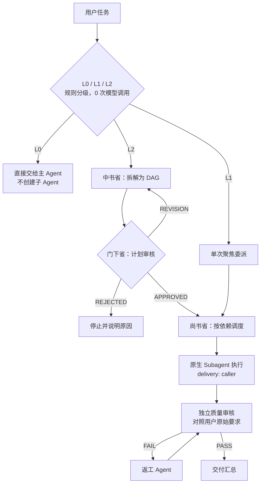

<!-- prettier-ignore -->
<div align="center">


# 三省六部制 · Three Departments & Six Ministries

**给 DeepSeek Harness 的任务规划、审核、调度与验收插件**

[](https://github.com/deepseek-ai/deepseek-harness)
[](https://nodejs.org)
[](LICENSE)
[](#开发与测试)

[为什么用它](#为什么用它) • [安装](#安装) • [快速开始](#快速开始) • [工作方式](#工作方式) • [配置](#配置) • [安全边界](#安全边界)

</div>

它把一件复杂任务交给人来管的流程搬到了 Agent 里：**先拆解、再审核、按依赖调度、最后独立验收**。
所有子任务都跑在 Harness 原生的 Subagent 上，插件本身不执行任何命令、不扩权、不改 DSH 核心。

> [!NOTE]
> 这不是角色扮演插件，也不是给 Agent 加几个古代官职称谓。`中书省` / `门下省` / `尚书省` 是三个真实的编排阶段：
> 规划子 Agent、审核子 Agent、调度器。`六部` 是执行阶段按需生效的能力切片，不会为每个部门都开一个 Agent。

> [!IMPORTANT]
> 默认**先问再跑**。`requireApproval` 打开时，每次可能创建子 Agent 的调用都会先走宿主审批，
> 不会静默消耗 Token。简单任务被判为 L0 时不会创建任何子 Agent（实测 0 次调用、0 Token）。

## 为什么用它

| 没有它 | 有了它 |
| --- | --- |
| 复杂任务一步做完，漏掉的需求没人发现 | 先拆成带验收标准的子任务，再由独立角色审一遍计划 |
| 子任务之间要不要串行全凭模型临场判断 | 依赖关系显式建模，只并行真正无依赖的部分 |
| 「做完了」是执行者的自我声明 | 独立验收对照**用户原始要求**逐条核对，不通过就返工 |
| 一次跑飞了才知道花了多少钱 | Token / 成本 / 时间三重预算 + 真实用量回读 |

## 安装

> [!TIP]
> 需要先有 `pnpm`。从 GitHub 安装时 `pnpm` 会一并装上插件依赖，无需手动 `npm install`。

### 方式一：命令行（推荐）

```bash
# 任意可自定义的 profile，例如 web / tui
dsh plugin --profile web add github:OranJu086/dsh-sanshengliubu
```

Desktop 使用应用独占管理的 `desktop` profile，需要**先完全退出应用**再执行：

```bash
dsh plugin --profile desktop add github:OranJu086/dsh-sanshengliubu
```

`dsh` 来自 `@deepseek-ai/dsh`，可用 `npm i -g @deepseek-ai/dsh` 或 `npx @deepseek-ai/dsh` 调用。
安装会把包写入 profile 依赖并选中 bundle；未启用 HMR 的 profile 需重启一次。

> [!WARNING]
> 如果 pnpm 提示有依赖的构建脚本被拦截，请把报出的包名加进 profile 的 `pnpm-workspace.yaml` 的
> `allowBuilds` 后重试。本插件自身没有任何构建脚本。

### 方式二：Desktop 界面

在 Harness 里让 Agent 安装，等价于图形化的「插件 → 安装」：

```text
plugin_manager → install_bundle → target: github:OranJu086/dsh-sanshengliubu
```

开发时也可以直接用本地目录：

```text
plugin_manager → install_bundle → target: /绝对路径/到/dsh-sanshengliubu
```

> [!NOTE]
> 用本地目录安装时，profile 以链接方式引用该目录，**链接包自身的依赖不会被自动安装**；
> 请先在包目录执行一次 `npm install`，否则设置页不会生成配置表单。

安装完成后三个工具（`sansheng_run` / `sansheng_status` / `sansheng_config`）即可使用。
卸载：`plugin_manager → remove_bundle → target: dsh-sanshengliubu`。

## 快速开始

装好之后直接提要求即可，模型会自己判断要不要走工作流：

```text
把这个模块重构一下，补上测试，最后给我一份中文说明
```

想强制走完整流程，点名即可：

```text
用三省六部跑：在 scripts/ 下做一个可测试的构建脚本
```

觉得它过度设计了：

```text
这个很简单，别开三省，你直接做
```

随时可以查进度或调预算：

```text
三省六部现在跑到哪一步了？
把三省的任务预算降到 10 万 Token，并行数改成 2
```

## 工作方式



### 三个等级

| 等级 | 触发 | 行为 | 模型调用 |
| --- | --- | --- | --- |
| **L0** | 规则评分低 | 只回「请直接完成」，不创建子 Agent | 0 |
| **L1** | 规则评分中 | 一次聚焦委派 + 规则审核 | 1 个执行子 Agent |
| **L2** | 规则评分高 | 规划 → 审核 → 依赖调度 → 独立验收 → 返工 | 3～10 个 |

复杂度评分只看规则（文本长度、句段数、信号词、涉及文件数、自定义关键词），**不花模型调用**。
阈值与关键词都在配置里，调用方也能用 `level` 直接指定。

### 三个工具

| 工具 | 用途 |
| --- | --- |
| `sansheng_run` | 跑一次工作流。参数：`task`、`requirements`、`level`、`subtasks`、`skip_review`、`max_subagents`、`max_tokens`、`time_limit` |
| `sansheng_status` | 查运行中/最近的工作流、部门进度、子任务、预算、审核结论、角色成功率 |
| `sansheng_config` | `show` / `set` / `reset` 运行期配置 |

## 配置

三种改法，优先级从高到低：

1. **会话内**：`sansheng_config set {"taskBudget":100000}`，立即生效并持久化到插件状态目录
2. **宿主设置页**：插件导出 `Config` Schema，宿主自动生成表单（开关、预算、并行、审核、角色路由）
3. **profile patch**：按行 id `sansheng-liubu` 覆盖，适合版本化管理

最常改的几个：

| 字段 | 默认 | 说明 |
| --- | --- | --- |
| `enable` | `true` | 总开关；关闭后拒绝执行，但工具保留以便随时打开 |
| `requireApproval` | `true` | 调用前审批，不静默花 Token |
| `maxSubagents` | `4` | 同时运行的子 Agent 数 |
| `maxReviewRounds` | `2` | 验收不通过后的返工轮数 |
| `taskBudget` | `400000` | 单次工作流 Token 预算 |
| `modelPrices` | `{}` | 美元/百万 Token，用于成本预算；未定价模型只统计 Token |

完整字段见 [架构说明](docs/ARCHITECTURE.md)。

## 安全边界

- **不扩权**：子 Agent 继承父 Agent 的沙箱、权限根与审批策略，插件没有绕过路径
- **不后台跑**：没有定时器、轮询或常驻任务，不调用就什么都不做
- **不写会话日志**：工作流数据落插件自己的状态目录（`$DSH_HOME/sansheng-liubu`），不向 Session 追加事件类型
- **不伪造**：未运行的测试、未读到的文件不允许声称完成，验收方按未完成处理
- **不静默**：`requireApproval` 每次创建子 Agent 前都走宿主审批，审计里留有 `approval/ask` 记录

## 项目结构

<details>
<summary>展开查看模块划分</summary>

```text
.
├── index.js              # 包入口（apply / Config / inject / name）
├── cordis.patch.yml      # bundle patch（含完整默认配置）
├── lib/
│   ├── index.js          # 装配：配置归一化、状态目录、提示段、审批闸门、注册工具
│   ├── schema.js         # Config Schema（宿主设置表单）
│   ├── config.js         # 默认值 / 校验 / 归一化
│   ├── classify.js       # 中书省：L0/L1/L2 规则分级
│   ├── plan.js           # 中书省：计划归一化、依赖校验、拓扑分层
│   ├── prompts.js        # 三省 / 六部 / 审核 / 返工 提示词
│   ├── runner.js         # 尚书省：编排、重试、审核、返工、汇总
│   ├── agents.js         # 原生 Subagent 桥（startActivation / delivery: caller）
│   ├── usage.js          # 户部：从子会话日志回读真实 usage
│   ├── budget.js         # 户部：Token / 成本 / 时间预算
│   ├── state.js          # 状态、审计、角色统计、运行期覆盖
│   ├── render.js         # 礼部：交付报告与状态视图
│   ├── tools.js          # 三个工具定义
│   └── util.js           # 纯工具函数
├── test/unit.test.js     # 34 个纯模块单测
├── demo/                 # 一次真实 L2 工作流的产物（词频工具）
└── docs/                 # 架构说明、测试报告
```

</details>

## 开发与测试

```bash
npm install          # 仅需 @deepseek-ai/schemastery
npm test             # node --test test/*.test.js → 34 passing
```

领域模块都是纯函数，绝大多数逻辑可脱离 Harness 直接测。集成测试跑的是**真实工作流**：
6 次运行、11 项用例，含一次 8 个子 Agent、11 分 53 秒的 L2 全流程，记录见 [测试报告](docs/TEST-REPORT.md)。

改完代码后重载插件（链接安装不会自动热更新）：

```text
plugin_manager → set_bundle → enabled: false
plugin_manager → set_bundle → enabled: true
```

## 已知限制

- **预算对验收是软约束**：预算耗尽后停止派发新子任务，但独立验收仍会执行，总用量可能超出一轮验收的量（实测 150k 预算用 197.8k）
- **无自定义面板**：只有宿主自动生成的设置表单 + 工具卡片；实时进度面板需要 Client 插件，属下一步
- **计划审核用尽返修改数后带风险继续**，并写入 `approved-with-risk`，不会无限循环
- **成本只在配置 `modelPrices` 时生效**，未配置的模型计入 `unpricedTokens`
- **返工新建 fixer 子 Agent**，不唤醒原执行 Agent（换来确定性与可测性）

## 相关文档

- [架构说明](docs/ARCHITECTURE.md) — 运行时实测结论、分层、状态机、失败恢复策略
- [测试报告](docs/TEST-REPORT.md) — 用例矩阵、实测证据、崩溃事件复盘
- [LICENSE](LICENSE)
